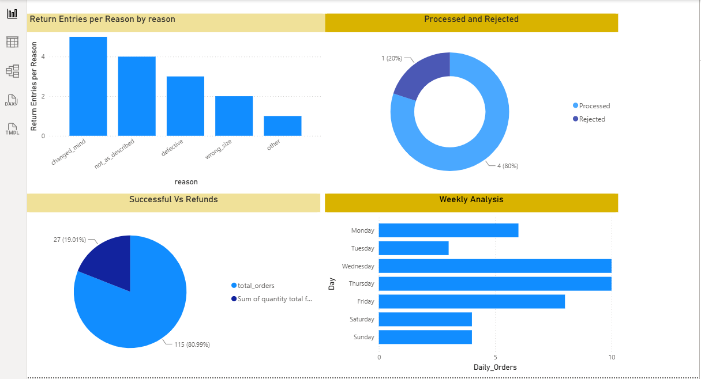
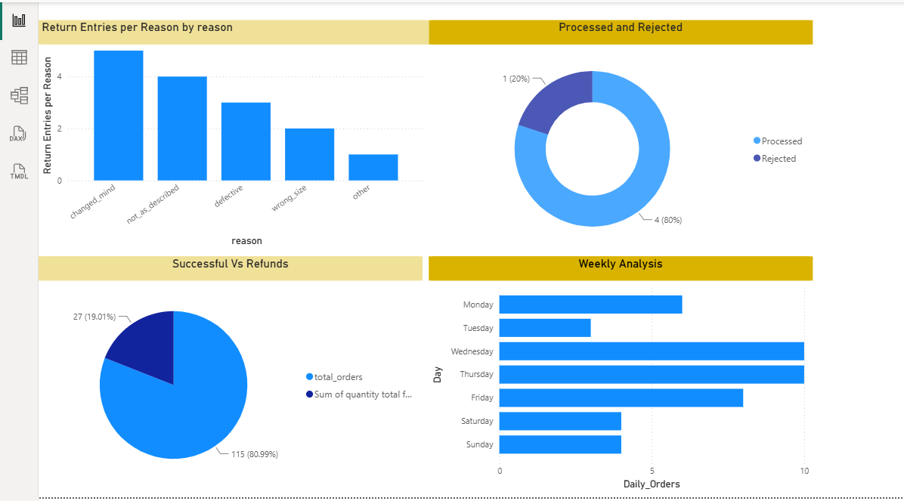
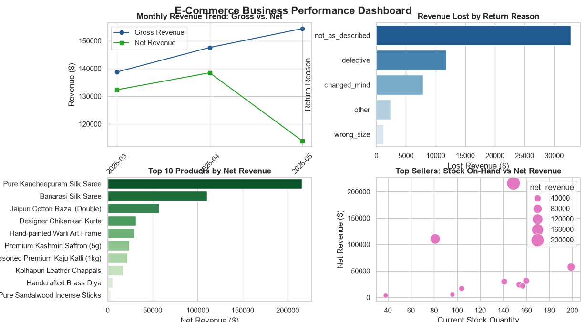

A simple project that uses SQL to store and query data, Python to visualize it, and a dashboard to present the key insights.

## Project Structure

| File | Description |
|------|-------------|
| `Tables.sql` | SQL scripts to create the database tables |
| `Queries.sql` | SQL queries used to analyze the data |
| `Plots.py` | Python script that generates the visualizations |
| `Dashboard` | Dashboard configuration/export |
| `d1.PNG`, `d2.png` | Dashboard screenshots |
| `python_plot.png` | Sample output from `Plots.py` |

## How to Use

1. Run `Tables.sql` in your SQL database to create the tables and load your data.
2. Run the queries in `Queries.sql` to explore and analyze the data.
3. Install the required libraries and run the plotting script:
   ```bash
   pip install pandas matplotlib
   python Plots.py
   ```
4. Open the dashboard to view the results.

## Preview





## Tools Used

- SQL
- Python (pandas, matplotlib)
- Dashboard tool

## Author

[bhprateek22-alt](https://github.com/bhprateek22-alt)
